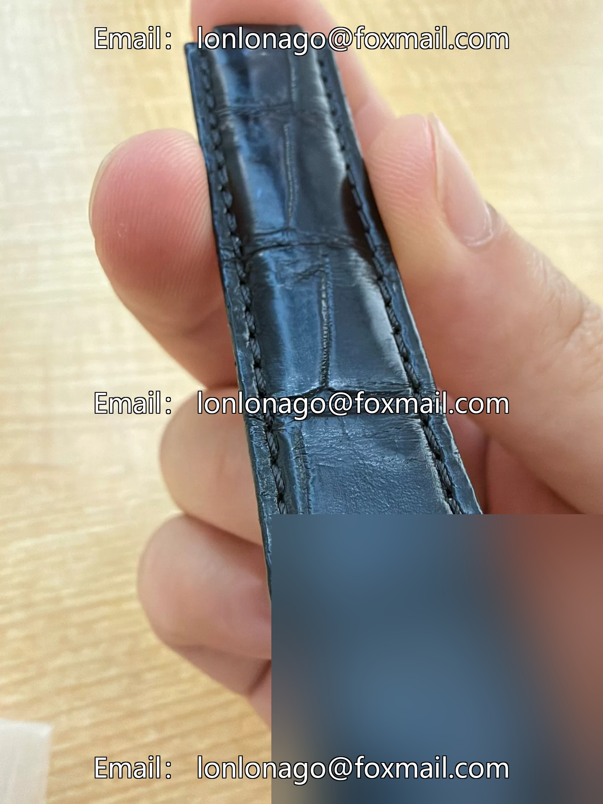
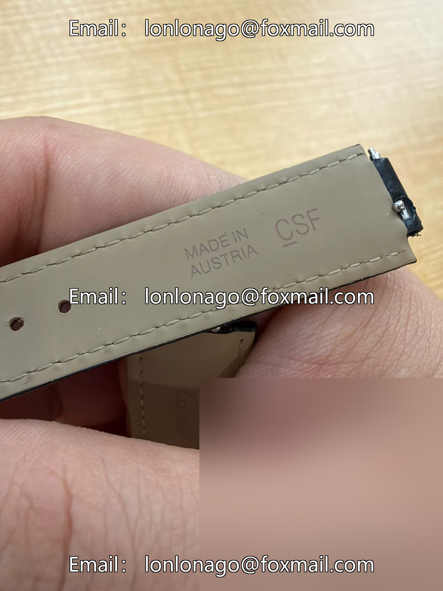
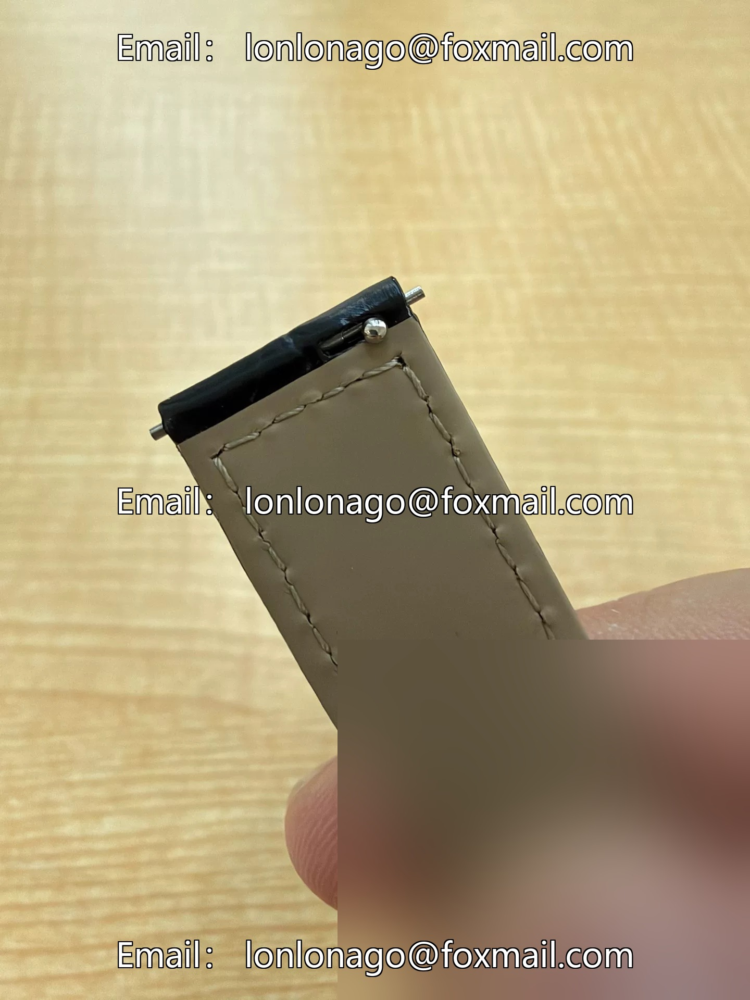

# Cartier genuine crocodile leather quick-release watch band

## Body

Cartier original crocodile skin quick-rebind watch band
Bought it and never used it, custom, garbage condition
Supports in-store verification, any fake will be given away

Number KD2JJK97, in the Cartier system it mainly corresponds to the Ballon Bleu series (crocidermate watch band, women's/small, approximately 12mm wide on the dial end, 16-17mm wide on the fold buckle end).
The leather is produced by the Austrian CSF factory, made of crocidermate, hand-stitched, with meticulous craftsmanship.
The condition shows obvious use traces, see the figure for details.
It is suitable for replacing watches in Cartier's Ballon Bleu and other series, supports quick-release function.
Directly shoot here, please communicate privately if there are issues.

The Cartier original crocodile fast-open watch band, shown by image, references CSF manufacturing, MADEIN and AUSTRIA.

<!-- AI_ENRICHED -->

## Images

## Payment

Here is a pay link on Stripe ( https://buy.stripe.com/3cs8yP7sY87d0vu9AB ). Please contact me lonlonago@foxmail.com after funding $89, and I will send you a complete data files , thank you!

